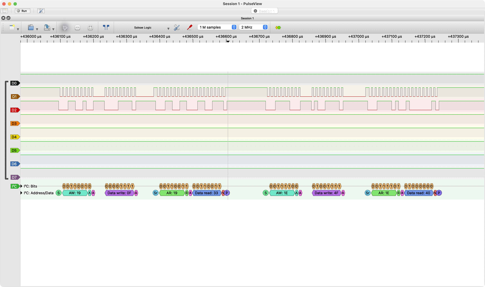

# EE186 Lab 3: I2C You!

## 2. Getting Ready

### 2a.

The accelerometer's address is `0011001b` and the magnetometer's is `0011110b`, where `b` is the r/w bit.

### 2b.

The sub-address identifies an internal register within the sensor. The I²C address selects which device on the bus to communicate with, while SUB selects which register within that device to read or write.

### 2c.

`CTRL_REG1_A` we can see on table 26 that it is at address 0x20. In temrs of what to set it, the bits 4-7 control the data rate selection. We can set it to 100 Hz by setting those 4 bits to 0101. But 3 is the power mode, which we want as normal, which is bit 0. And then bits 0-2 are enabling each axis, all of which should be enabled. In hex this becomes setting thsi register to 0x57.

### 2d.

We see this on page 51, where we see the addresses of the components. There are modes where these values take on up to 12 bits, so we need 2 registers and the follow sub-addresses to read them:

X-axis acceleration: OUT_X_L_A at `0x28` and OUT_X_H_A at '0x29`

Y-axis acceleration: OUT_Y_L_A at `0x2A` and OUT_Y_H_A at '0x2B`

Z-axis acceleration: OUT_Z_L_A at `0x2C` and OUT_Z_H_A at '0x2D`

## 3. Writing the Driver

From the datasheet, we expect WHO_AM_I_A to be `0x33` and WHO_AM_I_M to be `0x40`, which is exactly what we see here in the blue boxes.

## 4. Measuring Gravity

